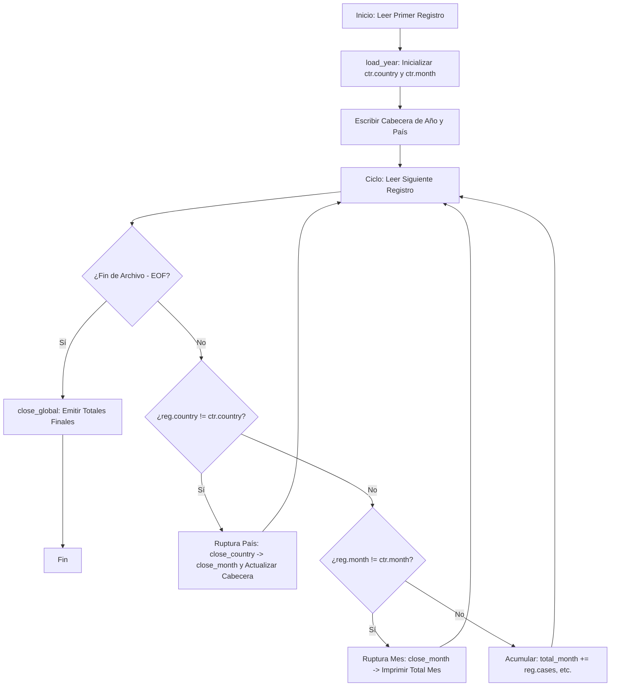

# Análisis COVID-19 (Corte de Control / Control Break)

[](https://github.com/dayher/analisis_covid/actions)
[](https://en.wikipedia.org/wiki/C99)
[](LICENSE)
[]()
[](https://dayher.github.io/analisis_covid/)

Este repositorio contiene un proyecto en **ANSI C** diseñado para realizar procesamiento y agregación de datos epidemiológicos de COVID-19 mediante el algoritmo clásico de **Corte de Control (Control Break)**. El proyecto cuenta con un sistema de compilación estricto, suite de pruebas automatizadas, tubería de CI/CD (GitHub Actions) y un **Dashboard Web Interactivo** para su visualización y simulación.

> 🌐 **Prueba el simulador interactivo y visualización de datos en vivo en:**  
> [**dayher.github.io/analisis_covid**](https://dayher.github.io/analisis_covid/)

---

## 📖 Tabla de Contenidos
- [Características del Proyecto](#-características-del-proyecto)
- [Algoritmo de Corte de Control](#%EF%B8%F0-algoritmo-de-corte-de-control)
- [Acceso Directo Indexado (names.bin)](#%EF%B8%F0-acceso-directo-indexado-namesbin)
- [Estructura del Proyecto](#%EF%B8%F0-estructura-del-proyecto)
- [Compilación y Uso Local](#-compilación-y-uso-local)
- [Pruebas Automatizadas](#-pruebas-automatizadas)
- [CI/CD con GitHub Actions](#-cicd-con-github-actions)
- [Licencia](#-licencia)

---

## ✨ Características del Proyecto

*   **Lógica Modular en C**: Separación clara de responsabilidades en la validación de argumentos, operaciones de archivo, análisis sintáctico de CSV y lógica de agrupación.
*   **Código C Estricto y Seguro**: Refactorizado bajo estándares modernos de compilación (`-Wall -Wextra -Werror -std=c99 -pedantic`), libre de advertencias (*warnings*), fugas de memoria y dependencias obsoletas.
*   **Optimizaciones de Memoria**: Uso de acceso directo indexado a archivos binarios de longitud fija en lugar de cargar bases de datos de texto complejas en la memoria RAM.
*   **Suite de Pruebas Integrada**: Script automatizado en Bash para verificar la regresión del programa.
*   **Dashboard Interactivo**: Aplicación web estática (HTML/CSS/JS) responsiva con tema oscuro y glassmorphism que simula la ejecución paso a paso del código C.

---

## 🔀 Algoritmo de Corte de Control

El programa requiere un archivo CSV de entrada **ordenado secuencialmente** por país y fecha (mes). A medida que lee cada línea, el algoritmo evalúa si la clave del registro ha cambiado para emitir subtotales y reiniciar acumuladores.



---

## 🗄️ Acceso Directo Indexado (`names.bin`)

Para obtener el nombre correspondiente a cada código numérico de país sin consumir memoria RAM excesiva, el programa lee el archivo binario indexado de longitud fija `names.bin`. 

Cada registro en `names.bin` mide exactamente **150 bytes** (`MAX_CHAR_NAME`). La función `get_name` busca la posición del país de forma directa mediante la función `fseek`:

$$\text{Desplazamiento (Offset)} = (\text{Código del País} \times 150) - 1$$

El script de Python `scripts/generate_names.py` permite compilar el catálogo original `iso3166.csv` en este binario estructurado para facilitar la reproducibilidad completa del proyecto.

---

## 📁 Estructura del Proyecto

```text
├── .github/workflows/   # Pipeline de CI/CD (GitHub Actions)
├── docs/                # Código fuente del Dashboard Interactivo (GitHub Pages)
│   ├── index.html       # Interfaz Glassmorphic
│   ├── style.css        # Estilos modernos de tema oscuro
│   └── app.js           # Motor de simulación y gráficos
├── scripts/             # Scripts de utilidad
│   └── generate_names.py# Generador de base binaria names.bin
├── tests/               # Suite de pruebas automatizadas
│   ├── expected_output.txt # Resultados correctos esperados
│   └── run_tests.sh     # Ejecutor de pruebas
├── makefile             # Script de compilación estricta
├── main.c / main.h      # Inicialización y validación de argumentos
├── control.c            # Máquina de estados del Corte de Control
├── input.c              # Lectura y parseo del archivo CSV
├── output.c             # Formateo de salida
├── names.c / names.h    # Mapeo binario de países
├── io.h                 # Estructuras de datos principales
├── data.csv             # Conjunto de datos COVID de muestra
└── iso3166.csv          # Listado de países y códigos numéricos
```

---

## 🛠️ Compilación y Uso Local

### Requisitos Previos
*   Un compilador de C compatible con C99 (como `gcc` o `clang`).
*   La herramienta `make` instalada en tu sistema.
*   Python 3 instalado para la generación de la base de datos binaria.

### Instrucciones paso a paso
1.  **Clonar el repositorio:**
    ```bash
    git clone https://github.com/dayher/analisis_covid.git
    cd analisis_covid
    ```

2.  **Generar el archivo binario de países:**
    ```bash
    python3 scripts/generate_names.py
    ```

3.  **Compilar el programa en C:**
    ```bash
    make
    ```

4.  **Ejecutar el analizador de COVID-19:**
    ```bash
    ./analisis_covid -in data.csv -out output.txt
    ```

5.  **Revisar los resultados generados:**
    ```bash
    cat output.txt
    ```

---

## 🧪 Pruebas Automatizadas

El proyecto incluye un script de prueba integrado que compila la aplicación, genera los binarios requeridos, realiza ejecuciones contra datos de prueba y compara la salida obtenida con los resultados esperados:

```bash
bash tests/run_tests.sh
```

---

## 🚀 CI/CD con GitHub Actions

Cada cambio realizado en las ramas principales de este repositorio activa de forma automática una acción en GitHub (`.github/workflows/ci.yml`) que:
1.  Verifica el entorno instalando un compilador nativo y Python.
2.  Ejecuta la compilación con directivas estrictas (`-Wall -Wextra -Werror -pedantic`).
3.  Ejecuta el script de pruebas de regresión.
4.  Garantiza que el repositorio siempre contenga código estable y correcto.

---

## 📄 Licencia

Este proyecto está distribuido bajo la licencia MIT. Consulta el archivo `LICENSE` para más información.
